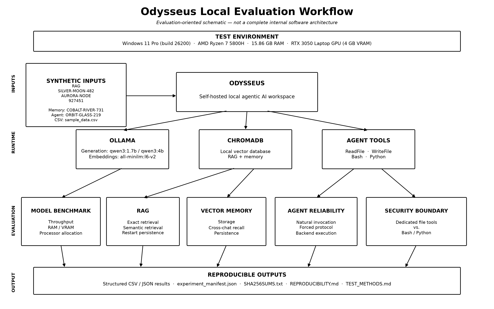
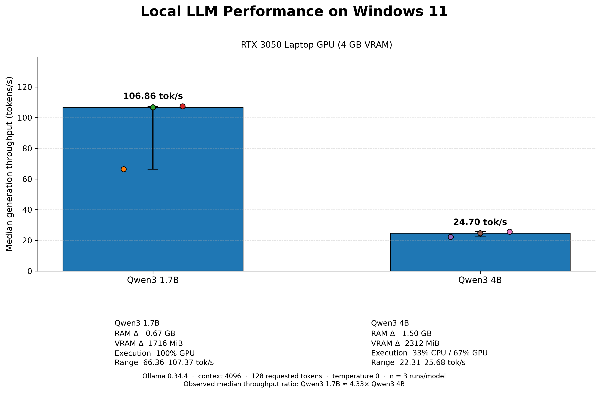
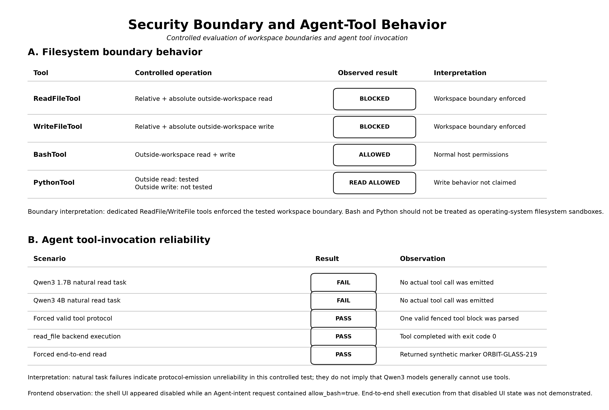

# Odysseus Local AI Windows Evaluation

Reproducible systems evaluation of a self-hosted agentic AI workspace on constrained consumer hardware.

This repository evaluates **Odysseus** on Windows 11 with local LLM inference, retrieval-augmented generation (RAG), vector memory, agent-tool execution, filesystem-boundary behavior, resource usage, and reproducibility controls.

> This repository is an independent evaluation artifact. It does not claim authorship of Odysseus itself.

## Overview

Self-hosted agentic AI workspaces combine several components that must work together reliably: local model serving, embeddings, vector storage, retrieval, persistent memory, tool execution, user-interface policy, operating-system permissions, and limited hardware resources.

This project evaluates how those components behave when Odysseus is deployed on a consumer Windows laptop with **16 GB RAM and a 4 GB NVIDIA RTX 3050 Laptop GPU**. The study focuses on practical deployment rather than claiming a universal benchmark of Odysseus or the tested models.

The evaluation covers five areas:

- local LLM inference performance and resource use;
- controlled RAG retrieval and restart persistence;
- cross-conversation vector-memory behavior;
- agent tool-invocation reliability; and
- workspace/file-access boundaries for dedicated file tools versus executable Bash/Python tools.

All publication-facing tests use **synthetic fixtures**, and the experimental package includes structured result files, an experiment manifest, reproducibility documentation, and SHA-256 integrity verification.

## Research questions

The evaluation is organized around five research questions:

**RQ1 — Deployment feasibility.**  
Can the Odysseus stack run practically on constrained consumer Windows hardware?

**RQ2 — Local model performance.**  
How do Qwen3 1.7B and Qwen3 4B compare in generation throughput, observed RAM/VRAM use, and deployment fit on the tested machine?

**RQ3 — Retrieval and memory reliability.**  
Do local RAG and vector-memory functions work reliably in controlled synthetic tests, including retrieval after restart and recall across conversations?

**RQ4 — Agent tool reliability.**  
How reliably do the tested local models autonomously emit the tool protocol required by the Odysseus agent loop, and does the parser/backend execute correctly when valid protocol is supplied?

**RQ5 — Workspace boundary behavior.**  
What boundary does the selected workspace provide for dedicated file tools compared with executable Bash/Python tools operating with normal host permissions?

## Evaluation workflow

<p align="center">
  
</p>

**Figure 1.** Evaluation-oriented workflow for the local Odysseus study. Synthetic fixtures are exercised through Odysseus, Ollama, ChromaDB, and agent tools, followed by model-performance, RAG, memory, agent-reliability, and workspace-boundary evaluations. Structured outputs are preserved with reproducibility metadata and SHA-256 integrity checks.

## Tested environment

| Component | Configuration |
|---|---|
| OS | Windows 11 Pro, build 26200 |
| CPU | AMD Ryzen 7 5800H, 8C/16T |
| RAM | 15.86 GB |
| GPU | NVIDIA GeForce RTX 3050 Laptop GPU |
| VRAM | 4096 MiB |
| NVIDIA driver | 621.01 |
| Python | 3.12.10 |
| Ollama | 0.34.4 |
| ChromaDB | 1.5.9 |
| Odysseus evaluation commit | `7b776b6ceb090f2d5374e1c0c7c8f2dae7fe81a7` |

## Models

| Model | Role | Stored size |
|---|---|---:|
| `qwen3:1.7b` | generation | ~1.4 GB |
| `qwen3:4b` | generation | ~2.5 GB |
| `all-minilm:l6-v2` | embeddings | ~45 MB |

Embedding dimension: **384**

## Headline benchmark results

Standardized configuration:

- Ollama 0.34.4
- context: 4096
- requested generation: 128 tokens
- temperature: 0
- thinking requested: false
- three measured runs per model
- alternating model order

| Metric | Qwen3 1.7B | Qwen3 4B |
|---|---:|---:|
| Throughput runs | 66.36, 106.86, 107.37 tok/s | 22.31, 24.70, 25.68 tok/s |
| **Median throughput** | **106.86 tok/s** | **24.70 tok/s** |
| Mean throughput | 93.53 tok/s | 24.23 tok/s |
| Min–max | 66.36–107.37 tok/s | 22.31–25.68 tok/s |
| Sample SD | 23.53 tok/s | 1.73 tok/s |
| Median observed RAM delta | 0.67 GB | 1.50 GB |
| Median observed VRAM delta | 1716 MiB | 2312 MiB |
| Processor allocation | 100% GPU | 33% CPU / 67% GPU |

In this specific standardized configuration, Qwen3 1.7B achieved about **4.33×** the median generation throughput of Qwen3 4B.

This is a machine- and configuration-specific result, not a universal model-speed ratio.


<p align="center">
  
</p>

**Figure 2.** Local inference performance for Qwen3 1.7B and Qwen3 4B on the tested Windows 11 laptop. Points show the three measured runs, bars show median generation throughput, and whiskers show the observed min–max range. Resource annotations summarize median observed RAM/VRAM deltas and processor allocation for the tested configuration.

## RAG results

| Test | Result |
|---|---|
| Direct vector retrieval | PASS |
| Exact fact retrieval | PASS |
| Semantic fact retrieval | PASS |
| Retrieval after service restart | PASS |

Detailed results: [`results/rag_results.csv`](results/rag_results.csv)

## Vector memory results

| Test | Result |
|---|---|
| Manual synthetic memory storage | PASS |
| Fresh-conversation recall | PASS |
| Continued vector-memory availability | PASS |

Synthetic memory marker: `COBALT-RIVER-731`

Detailed results: [`results/memory_results.csv`](results/memory_results.csv)

## Agent tool reliability

| Test | Result |
|---|---|
| Qwen3 1.7B natural tool invocation | FAIL |
| Qwen3 4B natural tool invocation | FAIL |
| Forced valid tool protocol parsed | PASS |
| `read_file` backend execution | PASS |
| Forced end-to-end tool workflow | PASS |

The supported interpretation is narrow:

> In this controlled Odysseus task, both tested Qwen models were unreliable at autonomously emitting the textual tool protocol required by the agent loop, while the parser/backend path worked when valid protocol was supplied.

This does **not** imply that Qwen3 models cannot use tools in general.

Detailed results: [`results/agent_tool_results.csv`](results/agent_tool_results.csv)

## Filesystem boundary findings

Dedicated file tools:

| Test | Result |
|---|---|
| Relative read outside workspace | BLOCKED |
| Absolute read outside workspace | BLOCKED |
| Relative write outside workspace | BLOCKED |
| Absolute write outside workspace | BLOCKED |

Executable tools:

| Test | Result |
|---|---|
| Bash read outside workspace | ALLOWED |
| Bash write outside workspace | ALLOWED |
| Python read outside workspace | ALLOWED |

Interpretation:

- the tested dedicated file tools enforced the selected workspace boundary;
- Bash and Python used the workspace as an initial working directory rather than an OS-level filesystem sandbox;
- executable tools retained normal host operating-system permissions.

A separate frontend/request-state inconsistency was also observed: the shell UI could appear disabled while an Agent-intent request contained `allow_bash=true`. Successful shell execution from that exact disabled UI state was **not** demonstrated.

Detailed results: [`results/security_results.csv`](results/security_results.csv)


<p align="center">
  
</p>

**Figure 3.** Summary of the tested filesystem boundary and agent-tool behavior. Dedicated `ReadFile`/`WriteFile` tools enforced the tested workspace boundary, while Bash and Python retained normal host permissions in the tested cases. Agent-tool failures are scoped to protocol emission in the controlled task; they do not imply that Qwen3 models generally cannot use tools.

## Windows deployment observations

The evaluation encountered several reproducibility-relevant integration issues:

- missing `typing.Any` import in the tested Odysseus baseline;
- earlier NVIDIA driver incompatibility during local GPU inference setup;
- Windows proxy settings interfering with localhost Python/httpx traffic;
- ChromaDB requiring a separate local service;
- embedding-model setup;
- embedding cold-start timeout under Ollama 0.34.4;
- optional MCP integration failures independent of core local RAG/vector memory;
- runtime-version drift across experimental dates.

These are recorded as deployment observations and are not automatically classified as upstream defects.

## Repository structure

```text
odysseus-evaluation/
├─ benchmarks/
│  ├─ environment_snapshot.ps1
│  └─ ollama_model_benchmark.ps1
│
├─ fixtures/
│  ├─ agent_note.txt
│  ├─ memory_synthetic_fact.txt
│  ├─ rag_synthetic_document.txt
│  └─ sample_data.csv
│
├─ public-evidence/
│  ├─ figures/
│  ├─ scripts/
│  └─ source-data/
│
├─ reproducibility/
│  ├─ experiment_manifest.json
│  ├─ generate_hashes.ps1
│  ├─ REPRODUCIBILITY.md
│  ├─ SHA256SUMS.txt
│  ├─ TEST_METHODS.md
│  └─ verify_hashes.ps1
│
└─ results/
   ├─ archive/
   ├─ model_benchmarks.csv
   ├─ model_benchmark_summary.csv
   ├─ rag_results.csv
   ├─ memory_results.csv
   ├─ agent_tool_results.csv
   └─ security_results.csv
```

## Reproduce the benchmark

See:

- [`reproducibility/REPRODUCIBILITY.md`](reproducibility/REPRODUCIBILITY.md)
- [`reproducibility/TEST_METHODS.md`](reproducibility/TEST_METHODS.md)

Example benchmark:

```powershell
cd D:\Projects\odysseus-evaluation

& .\benchmarks\ollama_model_benchmark.ps1 `
    -Model "qwen3:1.7b"
```

## Verify artifact integrity

```powershell
& .\reproducibility\verify_hashes.ps1
```

Frozen package result:

```text
Passed: 24
Failed: 0
INTEGRITY CHECK: PASS
```

## Reproducibility policy

Material environment changes should be treated as a new experimental epoch.

Do not silently combine benchmark data collected under different Ollama versions, model revisions, NVIDIA drivers, Odysseus revisions, or operating-system configurations.

Historical September benchmark data is preserved separately from the standardized October dataset.

## Limitations

- one Windows laptop;
- two generation models;
- three standardized runs per model;
- fixed context of 4096;
- fixed 128-token generation limit;
- small controlled agent task;
- synthetic RAG and memory fixtures;
- controlled boundary study rather than penetration testing;
- version-specific behavior.

## Safety and privacy

The evaluation uses synthetic fixtures for publication.

Recommended operating assumptions:

- keep Odysseus, Ollama, and ChromaDB bound to localhost;
- retain authentication;
- do not expose raw model ports publicly;
- do not use real secrets or credentials in test fixtures;
- do not assume the workspace is an OS sandbox for Bash/Python;
- review MCP integrations before enabling untrusted servers.

## Attribution

Odysseus is an external open-source project evaluated by this repository.

Upstream:
https://github.com/odysseus-dev/odysseus

This repository contains independent evaluation scripts, structured results, synthetic fixtures, reproducibility documentation, and evidence produced for this study.

See `ATTRIBUTION.md` for additional project-attribution notes.

## Status

Release: **v1.0.0**

Release date: **2026-11-01**

Experimental evaluation package: **frozen**

Integrity verification: **24 / 24 artifacts passed**


